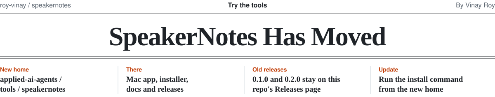

<picture>
  <source media="(prefers-color-scheme: dark)" srcset=".github/assets/moved-masthead-dark.svg">
  
</picture>

SpeakerNotes now lives in **[applied-ai-agents / tools / speakernotes](https://github.com/roy-vinay/applied-ai-agents/tree/main/tools/speakernotes)**,
next to Tech60. The app, installer, docs and new releases are there.

To install or update, paste this in Terminal:

```bash
curl -fsSL https://raw.githubusercontent.com/roy-vinay/applied-ai-agents/main/tools/speakernotes/install.sh | bash
```

Your notes and settings are kept. Releases 0.1.0 and 0.2.0 stay on this repository's
[Releases page](https://github.com/roy-vinay/speakernotes/releases), and the code before the move is in
this repository's history.
